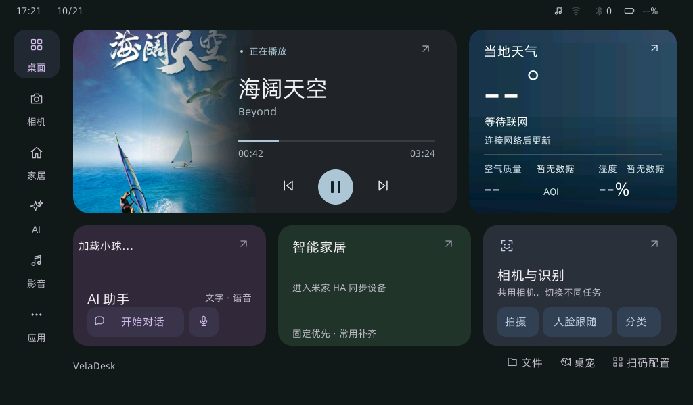
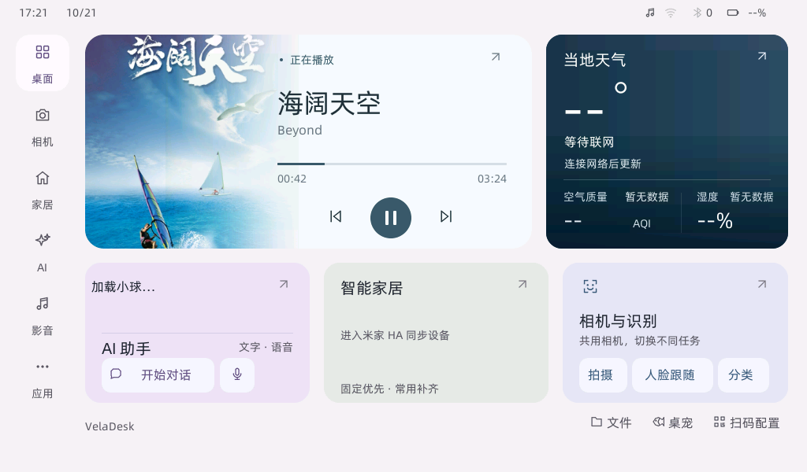

# 桌面与应用未提交改动整理 · 2026-10-21

本批次将共享主题与相互依赖的运行时、页面及生成资源作为一次源码集成提交；安装资源单独整理，保留既有 SD 包提交历史。当前曲目封面、异步蓝牙操作、相机保存和桌宠资源的服务生命周期随源码一起交付。

| 范围 | 行为 |
| --- | --- |
| 音乐 | 注册内置音乐应用，按入口返回桌面或应用列表；桌面显示当前曲目封面、进度与控制；采用“素雅漫透”卡片及几何居中的播放／暂停图案 |
| 歌词与字体 | 半椭圆滑动、递增延迟；字体选择放在设置；六款可选中文字体通过锁定来源生成 SD 字库，固件保留缺失／损坏回退 |
| 蓝牙 | 原生异步连接列表、扫描与连接代次、取消／断开和角色占用；HCI/GATT 操作保留常驻任务组所有权 |
| 相机 | 原生取景控件、比例与裁切、六款颜色、缩放、设备／模式选择；保存、视频和 USB 预览使用一致的画面区域 |
| 桌宠 | 外观资源迟到加载与热替换；缺失／损坏保留已显示资源；应用和独立预览同步 |
| 共享界面 | 原生 C、QuickJS 与配置网页共享主题；应用抽屉、侧栏、媒体、聊天、输入法和语音界面接入；同步分发脚本与嵌入 C 资源 |

## 本轮提交前检查

- 六份 JavaScript 测试文件：**238 项通过，0 失败**。覆盖相机、桌宠、家居前端、资源同步／身份边界、配置网页和四尺寸双主题布局。
- 生产宿主专项：蓝牙 central、USB camera pools、USB interfaces、camera sync、camera boundary、photo storage、photo store、lock photo、interface protocols 均通过。
- 助手平台：天气／家居适配边界、真实照片保存线程、取消及回执归属检查通过；设备、模型、音频和网络为离线替身。
- 桌宠：12 张图片、迟到加载、60 次替换、隐藏时替换、缺失及坏 CRC 回退通过；实际 QuickJS 绑定编译通过。
- SD 安装包：5 个包、50 个安装文件、721,379,830 字节解压内容的摘要及结构校验通过。
- 暂存前对新增／修改文本和本地历史素材运行常见凭据模式扫描，无匹配；扫描并非敏感内容完整性保证。用户明确选择历史素材仅保留本地。
- 源码空白检查通过；Python 工具以语法检查和对应执行结果验证。

USB 协议宿主脚本原先将输出目录直接当作模拟挂载根路径；本轮深层输出目录超出生产 32 字节挂载路径缓冲的假定，导致用例失败。现使用独立短临时目录，保持生产代码和断言不变；同一深层输出目录重跑通过，避免测试结果受构建目录长度影响。

JavaScript 命令：

```sh
node --test app/espdl-quickapp/tests/camera_upgrade.test.cjs app/espdl-quickapp/tests/dafeiyu.test.cjs app/espdl-quickapp/tests/homeassistant_frontend.test.cjs app/espdl-quickapp/tests/package.test.cjs app/espdl-quickapp/tests/portal_frontend.test.cjs app/espdl-quickapp/tests/unified_ui.test.cjs
```

专项运行参数见 [测试说明](../../app/espdl-quickapp/tests/README.md)。提交前的结果摘要与精选日志保存在 [检查记录目录](2026-10-21-desktop/verification.json)。

## 已完成的原生界面验证

本次会话已对生产 LVGL/QuickJS 页面运行 ASan/UBSan：音乐深浅主题、曲目变化、封面迟到与所有者隔离、60 次页面开关／重建通过。52×52 主按钮的暂停图案上下各留白 17 像素，播放图案上下各留白 18 像素；检查的是实际 RGB565 图案像素。

统一界面此前完成 47 页、双主题、282 次生命周期回归；输入法、其他页面和聊天／语音专项通过。它们与本轮重新执行的宿主专项分开记录。最新音乐卡片与统一界面说明见 [UNIFIED-UI.md](../../app/espdl-quickapp/UNIFIED-UI.md)。





本轮音乐改动已通过 P4 桌面和封面服务对象编译。本批次整理没有重新链接完整固件、烧录、冷启动或实际音视频／外围设备验收；宿主测试及历史记录不作为当前整机实板验收。

## 资源与提交边界

- `app/espdl-quickapp/assets/sd-pack/` 是既有成品安装包，附清单、摘要和来源；保留原资源提交历史。
- `app/jizura/upstream/JIZURA_CEP*.zip` 是原始上游压缩包，与已保存的上游源码及许可证一起归档。
- `materials/` 约 2.1 GiB 的历史截图、音频、日志及设备资料按用户选择仅保留本机，不纳入本次提交／推送。使用本机 `.git/info/exclude` 标明该目录是本地归档，不改变团队的 `.gitignore`。
- 原分支与远端的两份同内容实现提交存在不同身份；合并远端保留双方历史，避免强制推送或覆盖远端。
